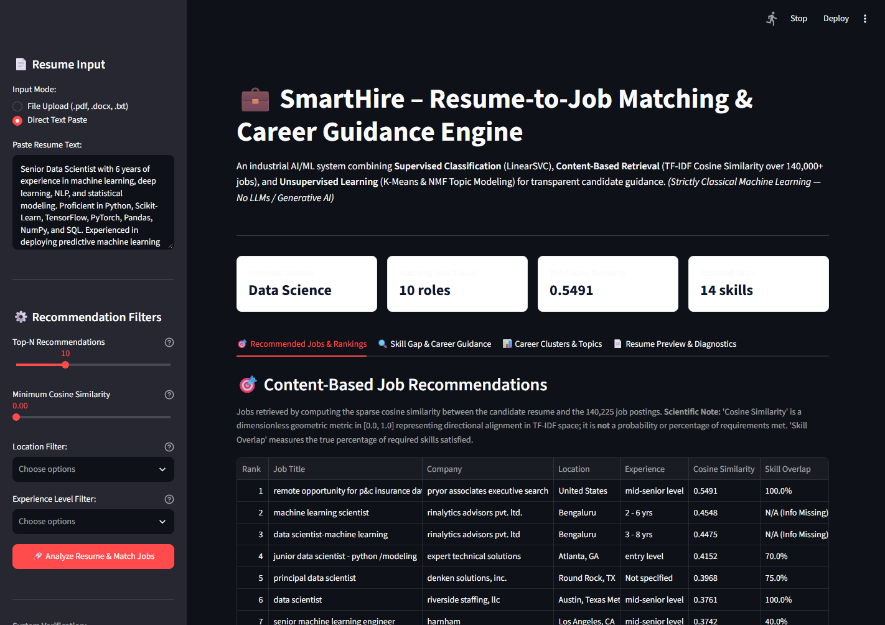

# SmartHire – Resume-to-Job Matching & Career Guidance Engine

An industrial-grade Machine Learning system combining supervised classification, content-based recommendation, and unsupervised latent semantic modeling to provide transparent, interpretable candidate-to-job matching, skill-gap diagnostics, and career guidance.

> **Project Type:** Industrial AIML Internship Project  
> **Host Organization:** Aenexz Tech Solutions  
> **Duration:** 3 Weeks  
> **ML Paradigm:** Strictly Classical Machine Learning (No Large Language Models or Generative AI APIs)  
> **Tested Environment:** Python 3.13.1 on Windows / Linux

---

## 1. Project Overview

SmartHire enables candidates to upload a resume (PDF, DOCX, or plain text) or paste raw text to receive immediate, transparent career analytics:

1. **Supervised Domain Classification (Model A):** Multi-class Linear Support Vector Classification (LinearSVC) classifying resumes across 25 career domains, accompanied by raw signed orthogonal decision margins ($w^T x + b$).
2. **Content-Based Job Recommendation:** High-throughput sparse TF-IDF Cosine Similarity engine retrieving ranked postings from a deduplicated corpus of **140,225 jobs**, featuring **Pre-Top-N filtering** across the complete eligible corpus.
3. **Canonical Skill-Gap Diagnostics:** Dictionary-driven technical skill extraction (157 canonical skills) with alias unification (e.g. `NLP` $\leftrightarrow$ `Natural Language Processing`) providing explicit matching skills, missing skills, and true percentage overlap.
4. **Unsupervised Job Family Discovery (K-Means):** MiniBatchKMeans ($K=6$) assigning the candidate to a grounded job family cluster while transparently flagging web-scraping template artifacts.
5. **Latent Semantic Topic Modeling (NMF):** Non-negative Matrix Factorization ($K=6$) computing raw document-topic loadings ($W$) across six latent semantic job dimensions.

### Problem Statement
Modern job seekers submit resumes to commercial job boards without knowing whether their qualifications semantically align with applicant tracking systems or which specific technical competencies they lack. At the same time, recruiters must parse tens of thousands of postings without interpretable vector similarity. SmartHire bridges this gap using transparent, auditable classical machine learning.

### Project Objectives
- Ingest and unify multi-source job datasets into a canonical 140,225-posting corpus without live web scraping.
- Train and validate a high-precision multi-class resume domain classifier across 25 career categories.
- Construct a sub-second, sparse cosine-similarity job recommendation engine with global pre-Top-N filtering.
- Design a canonical 157-skill extraction dictionary with bidirectional alias resolution to produce structured skill-gap reports.
- Discover natural job families via MiniBatchKMeans clustering ($K=6$) and latent themes via NMF topic modeling ($K=6$).
- Deliver an interactive, responsive 4-tab Streamlit dashboard providing full candidate inspection.

---

## 2. End-to-End System Architecture

```text
Candidate Input (PDF / DOCX / TXT / Paste)
                     │
                     ▼
┌───────────────────────────────────────────────────────────┐
│        Text Extraction & Preprocessing Pipeline          │
│   • Multi-format parsing (pypdf, python-docx, utf-8)      │
│   • clean_text(): URL, email, punctuation stripping       │
│   • Technical token preservation (C++, C#, .NET, R)      │
│   • 157-skill canonical extraction with alias resolution │
└─────────────┬───────────────────────────────┬─────────────┘
              │                               │
              ▼                               ▼
┌───────────────────────────┐   ┌───────────────────────────┐
│  Supervised Domain Model  │   │ Content-Based Recommender │
│  • LinearSVC (Model A)    │   │  • TF-IDF (10,000 vocab)  │
│  • 25 Career Categories   │   │  • Sparse Cosine Sim      │
│  • Repeated 3-Fold: 0.8620│   │  • 140,225 Job Postings   │
│  • Signed Decision Margins│   │  • Pre-Top-N Filtering    │
└─────────────┬─────────────┘   └─────────────┬─────────────┘
              │                               │
              ▼                               ▼
┌───────────────────────────┐   ┌───────────────────────────┐
│ Unsupervised K-Means (K=6)│   │   Unsupervised NMF (K=6)  │
│  • MiniBatchKMeans        │   │  • Coordinate Descent     │
│  • Inertia: 130,246       │   │  • Topic Diversity: 0.989 │
│  • Sampled Silhouette     │   │  • Raw W Document Loadings│
│  • Grounded Domain Labels │   │  • Latent Semantic Profile│
└─────────────┬─────────────┘   └─────────────┬─────────────┘
              │                               │
              └───────────────┬───────────────┘
                              │
                              ▼
┌───────────────────────────────────────────────────────────┐
│                Streamlit 4-Tab Dashboard                  │
│   Tab 1: 🎯 Recommended Jobs & Pre-Filtered Rankings     │
│   Tab 2: 🔍 Skill-Gap Diagnostics & Actionable Guidance   │
│   Tab 3: 📊 Career Clusters & NMF Latent Topics           │
│   Tab 4: 📄 Resume Preview, Counters & Diagnostics        │
└───────────────────────────────────────────────────────────┘
```

---

## 3. Machine Learning Components & Evaluation

| Component | Model / Algorithm | Hyperparameters / Details | Evaluation Metric / Finding |
|---|---|---|---|
| **Domain Classifier** | `LinearSVC` (Model A) | `C=1.0`, `loss='squared_hinge'`, `class_weight='balanced'`, TF-IDF (5k features, unigram+bigram) | **Repeated Stratified 3-Fold CV Macro F1: 0.8620 ± 0.0554** (Accuracy: 0.8918 ± 0.0388). Out-of-fold Macro F1: **0.871** (149/166 correct). Beats Logistic Regression (0.8521) and Dummy baseline (0.0058). |
| **Recommendation Engine** | Sparse TF-IDF Cosine Similarity | Sublinear TF, sub-second matrix multiplication ($< 80\text{ ms}$ over 140k rows) | **Exact Geometric Ranking:** Pre-Top-N candidate filtering across full corpus before top-$k$ selection. |
| **Job Clustering** | `MiniBatchKMeans` | $K=6$, `batch_size=2048`, `max_iter=100`, `n_init=3`, random seed 42 | **Inertia: 130,246.77**, sampled silhouette: $0.0163 \pm 0.0006$ (verified across 5 seeds). Grounded domain clusters. |
| **Topic Modeling** | `NMF` (Non-negative Matrix Factorization) | $K=6$, `init='nndsvda'`, `solver='cd'`, `beta_loss='frobenius'`, max_iter=200 | **Topic Diversity: 0.9889** (89 distinct terms out of 90). Fast training (6.2 s vs 175 s LDA). |
| **Skill-Gap Engine** | Canonical Dictionary Matcher | 157 skills, 40+ alias pairs, strict regex word boundaries (`\bC\b`, `\bR\b`) | Prevents false positives (`HR` hourly pay rate, `human services`) and false negatives (`NLP`/`Natural Language Processing`). |

### Model A Evaluation Protocol & Rationale
- **Primary Benchmark (Repeated Stratified 3-Fold CV):** Evaluated over 15 total folds (3 splits $\times$ 5 repeats, `random_state=42`) on the deduplicated 166-resume corpus across all 25 categories:
  - **LinearSVC:** Macro F1 = **0.8620 $\pm$ 0.0554**, Accuracy = **0.8918 $\pm$ 0.0388**, Weighted F1 = **0.8748 $\pm$ 0.0485**.
  - **Logistic Regression:** Macro F1 = **0.8521 $\pm$ 0.0413**, Accuracy = **0.8833 $\pm$ 0.0307**, Weighted F1 = **0.8635 $\pm$ 0.0372**.
  - **Majority-Class Baseline:** Macro F1 = **0.0058 $\pm$ 0.0006**, Accuracy = **0.0784 $\pm$ 0.0089**.
- **Out-of-Fold (OOF) Benchmark:** Single Stratified 3-Fold Cross-Validation (`random_state=42`) predicting on all 166 samples out-of-fold:
  - **LinearSVC OOF Macro F1 = 0.871**, Macro Precision = **0.887**, Macro Recall = **0.879**, Accuracy = **0.8976** (149/166 samples correctly classified).
  - This out-of-fold evaluation generated the confusion matrix plot saved at [`reports/figures/confusion_matrix_model_a.png`](file:///C:/SmartHire/reports/figures/confusion_matrix_model_a.png).
- **Why 3-Fold CV was Selected:** The minority class `PMO` contains only 3 samples in the deduplicated 166-resume corpus. Standard 5-fold cross-validation is mathematically invalid without dropping minority classes (triggering `UserWarning: The least populated class in y has only 3 members, which is less than n_splits=5`). A 3-fold split is the maximal stratified partition that guarantees at least 1 sample from every class in every validation fold. The 5 repeats (15 total folds) ensure statistical stability.

### Grounded Cluster Interpretations (K-Means, $K=6$)
- **Cluster 0:** *Accounting, Finance & Corporate Administration* (`accounting`, `financial`, `tax`, `audit`)
- **Cluster 1:** *Mixed Indian Postings (Naukri Web Scraping Boilerplate Dominant)* (`candidate profile`, `company profile`) — *Transparently audited and labeled as a scraping artifact.*
- **Cluster 2:** *Operations, Maintenance, Retail & Customer Support* (`maintenance`, `equipment`, `operations`, `customer`)
- **Cluster 3:** *Sales, Account Management & Digital Marketing* (`sales`, `business development`, `marketing`, `client`)
- **Cluster 4:** *Healthcare, Nursing & Clinical Care Services* (`patient`, `nursing`, `clinical`, `hospital`, `health`)
- **Cluster 5:** *Technical Engineering, Software Architecture & Data Systems* (`software`, `python`, `data`, `java`, `aws`)

### Grounded Latent Topics (NMF, $K=6$)
- **Topic 0:** *Mixed Business Mgmt, Sales & Financial Ops* (`business`, `management`, `financial`, `client`, `operations`)
- **Topic 1:** *Scraped Web / Naukri Template Artifact* (`candidate profile`, `company profile`, `keyskills`, `ug`, `pg`)
- **Topic 2:** *Healthcare, Nursing & Clinical Care* (`patient`, `nursing`, `care`, `registered nurse`, `clinical`, `hospital`)
- **Topic 3:** *Software Engineering & Technical Systems* (`software`, `development`, `design`, `engineering`, `technical`, `data`)
- **Topic 4:** *EEO & Legal Compliance Disclaimers* (`status`, `equal`, `opportunity`, `employer`, `disability`, `race`)
- **Topic 5:** *Mixed Customer Service, Retail & Facility Ops* (`customer`, `service`, `store`, `equipment`, `sales`, `safety`)

---

## 4. Datasets, Sources & Reproduction

### Dataset Attribution & Download Links
Per project guidelines, live scraping of commercial job boards is strictly avoided. Static public benchmark datasets are ingested from Kaggle:
1. **Updated Resume Dataset (Kaggle):**
   - **Source:** [Updated Resume Dataset by Gaurav Dutta](https://www.kaggle.com/datasets/gauravduttakiit/resume-dataset)
   - **Download Destination:** Place `UpdatedResumeDataSet.csv` into `data/raw/`
   - **Scope:** 962 raw resume records across 25 career domains. Deduplicated down to 166 unique records to eliminate data leakage across evaluation folds.
2. **Naukri.com Job Listings (Kaggle):**
   - **Source:** [Jobs on Naukri.com by PromptCloud](https://www.kaggle.com/datasets/promptcloud/jobs-on-naukricom)
   - **Download Destination:** Place `naukri_com-job_sample.csv` into `data/raw/`
   - **Scope:** 22,000 Indian tech and enterprise job listings.
3. **LinkedIn Job Postings 2023–2024 (Kaggle):**
   - **Source:** [LinkedIn Job Postings by Arsh Kon](https://www.kaggle.com/datasets/arshkon/linkedin-job-postings)
   - **Download Destination:** Extract `postings.csv`, `job_skills.csv`, `skills.csv`, and `companies.csv` into `data/raw/linkedin/`
   - **Scope:** 123,849 global enterprise postings with aggregated skill mappings and company metadata.

### Corpus Summary
| Dataset | File Path | Records | Scope & Features |
|---|---|---|---|
| **Resume Corpus** | `data/processed/cleaned_resumes.parquet` | 166 resumes | Labeled across 25 career domains (e.g. Data Science, HR, Java Developer, Advocate, Civil Engineer). Deduplicated and cleaned. |
| **Unified Job Corpus** | `data/processed/merged_job_corpus.parquet` | 140,225 jobs | Merged from Naukri (22,000) and LinkedIn (123,849) public datasets, deduplicated down to 140,225 records. Canonical schema: `title`, `company`, `location`, `skills`, `description`, `experience`. |
| **Job TF-IDF Matrix** | `models/job_tfidf_matrix.npz` | 140,225 $\times$ 10,000 | Serialized Compressed Sparse Row (`scipy.sparse.csr_matrix`, ~326 MB). |

### Dataset Reproduction Instructions
To reproduce the processed datasets and serialized models from raw Kaggle downloads:
1. Ensure the raw files are placed in `data/raw/` as specified above.
2. Execute the end-to-end preprocessing pipeline:
   ```bash
   jupyter nbconvert --to notebook --execute notebooks/01_eda.ipynb
   ```
   Or run the Python preprocessing routines in `src/data/preprocess.py`.
3. Train and persist Model A classifier and vectorizer:
   ```bash
   jupyter nbconvert --to notebook --execute notebooks/02_resume_classifier.ipynb
   ```
4. Fit and index the recommender sparse matrix, K-Means clustering, and NMF topic models:
   ```bash
   jupyter nbconvert --to notebook --execute notebooks/03_recommender.ipynb
   jupyter nbconvert --to notebook --execute notebooks/04_clustering_topics.ipynb
   ```

---

## 5. Project Directory Structure

```text
SmartHire/
├── app/
│   └── streamlit_app.py         # Complete 4-tab Streamlit dashboard interface
│
├── data/
│   ├── raw/                     # Original immutable public datasets
│   │   ├── UpdatedResumeDataSet.csv
│   │   ├── naukri_com-job_sample.csv
│   │   └── linkedin_job_postings/
│   ├── interim/                 # Intermediate merged / cleaned files
│   └── processed/               # Production model-ready Parquet datasets
│       ├── cleaned_resumes.parquet       (166 records)
│       └── merged_job_corpus.parquet     (140,225 records)
│
├── models/                      # Serialized production ML model artifacts
│   ├── classifier.pkl           # Model A LinearSVC (1.00 MB)
│   ├── tfidf_vectorizer.pkl     # Resume TF-IDF Vectorizer (202 KB)
│   ├── job_vectorizer.pkl       # Job Corpus TF-IDF Vectorizer (412 KB)
│   ├── job_tfidf_matrix.npz     # Sparse TF-IDF CSR Matrix (326 MB)
│   ├── kmeans_model.pkl         # MiniBatchKMeans K=6 (1.04 MB)
│   └── nmf_model.pkl            # NMF Latent Topic Model K=6 (480 KB)
│
├── notebooks/                   # Documented Jupyter research & audit notebooks
│   ├── 01_eda.ipynb             # Exploratory Data Analysis & corpus distributions
│   ├── 02_resume_classifier.ipynb # Supervised classifier benchmarking (LR, RF, SVM)
│   ├── 03_recommender.ipynb     # Recommender construction & skill-gap evaluation
│   └── 04_clustering_topics.ipynb# K-Means elbow/silhouette & NMF topic modeling audits
│
├── reports/                     # Audit logs, evaluations, and generated figures
│   ├── figures/                 # Visualizations, confusion matrix, and UI screenshots
│   └── final_report.pdf         # Comprehensive 10-page final project report
│
├── src/                         # Production application modules
│   ├── __init__.py
│   ├── config.py                # Centralized paths, hyperparameters, constants
│   ├── pipeline.py              # High-level pipeline coordinating parsing, ML & filtering
│   ├── data/
│   │   ├── load_data.py         # Corpus ingestion utilities
│   │   └── preprocess.py        # clean_text(), deduplication, schema normalization
│   ├── features/
│   │   ├── text_features.py     # TF-IDF vectorizer builders & serializers
│   │   └── match_features.py    # Skill extraction, overlap & alias normalization
│   ├── models/
│   │   ├── classifier.py        # Model A LinearSVC training, prediction & margins
│   │   ├── recommender.py       # JobRecommender engine & Pre-Top-N filtering
│   │   ├── clustering.py        # MiniBatchKMeans fitting, profiles & SVD projection
│   │   └── topic_modeling.py    # NMF model fitting, topic profiles & loadings
│   └── parsing/
│       └── resume_parser.py     # PDF (pypdf), DOCX (python-docx), and TXT extractors
│
├── tests/                       # Comprehensive automated test suite (61 tests)
│   ├── __init__.py
│   ├── test_classifier.py       # Supervised classification unit & integration tests
│   ├── test_clustering.py       # K-Means clustering, silhouette & profile tests
│   ├── test_features.py         # Text cleaning and skill overlap feature tests
│   ├── test_pipeline.py         # Parsing, Pre-Top-N filtering, and pipeline tests
│   ├── test_recommender.py      # Recommender ranking, skill edge cases & aliases
│   ├── test_streamlit_app.py    # Streamlit AppTest headless UI interaction tests
│   └── test_topic_modeling.py   # NMF topic modeling, synthetic fit & loadings tests
│
├── README.md                    # Comprehensive project documentation
└── requirements.txt             # Fully verified package dependencies
```

---

## 6. Streamlit Dashboard Features (4-Tab Layout)

The interactive dashboard is implemented in [`app/streamlit_app.py`](file:///C:/SmartHire/app/streamlit_app.py) with cached resource loading (`@st.cache_resource`):

### Top KPI Banner
Displays instantaneous candidate summary:
- **Predicted Domain:** Top classified career category from Model A.
- **Matching Jobs Found:** Number of eligible jobs satisfying all active filters.
- **Top Cosine Similarity:** Highest cosine similarity decimal scalar in $[0.0, 1.0]$.
- **Extracted Skills:** Count of identified canonical technical skills.

### Tab 1: 🎯 Recommended Jobs & Rankings
- **Pre-Top-N Filtering:** Evaluates location, experience level, and minimum cosine similarity against all 140,225 records before selecting the Top-N list.
- **High-Level Table:** Displays `Rank`, `Job Title`, `Company`, `Location`, `Experience`, `Cosine Similarity` (decimal), and `Skill Overlap` (percentage or `N/A`).
- **Expandable Job Cards:** Provides interactive cards showing matching technical skills (green tags), missing technical skills (red tags), corpus skill metadata, and the full job description.

### Tab 2: 🔍 Skill Gap & Career Guidance
- **Candidate Skill Inventory:** Badges for all canonical skills detected in the candidate's CV.
- **Posting Inspector:** Dropdown selector to inspect any recommended job's specific skill gap.
- **Aggregated Demand:** Analyzes recurring missing skills across all top recommended roles.
- **Objective Career Advice:** Direct recommendations derived strictly from recurring missing skills to guide portfolio projects without fabricated courses.

### Tab 3: 📊 Career Clusters & Latent Topics
- **Model A Decision Margins:** Displays top-3 signed LinearSVC distances ($w^T x + b$) from separating hyperplanes, clarifying that margins are geometric distances, not probabilities.
- **K-Means Job Family:** Reports assigned cluster ID and grounded interpretation, transparently flagging Cluster 1 as a web-scraping template artifact.
- **NMF Latent Topic Profile:** Interactive bar chart and table displaying raw document-topic loadings ($W$) across all 6 latent topics.

### Tab 4: 📄 Resume Preview & Diagnostics
- **Input Source Metadata:** Displays filename or direct paste designation.
- **Diagnostics Counters:** Reports raw character count and cleaned word count.
- **Cleaned Text Preview:** Displays preprocessed resume text after stripping HTML, URLs, and phone numbers while preserving technical language tokens (`C++`, `C#`, `.NET`, `Node.js`, `R`).

### Visual Dashboard & Evidence


*Figure 6.1: SmartHire Streamlit dashboard displaying candidate domain classification, KPI banner, pre-filtered recommendations, and skill overlap.*

---

## 7. Setup & Execution Instructions

### Prerequisites
- Python `3.13.1` (or compatible 3.10+ interpreter)
- ~2.5 GB available RAM for in-memory sparse matrix operations

### 1. Clone & Set Up Virtual Environment
```bash
# Clone the repository
git clone https://github.com/aenexz/SmartHire.git
cd SmartHire

# Create and activate virtual environment
python -m venv venv

# Windows (PowerShell):
.\venv\Scripts\Activate.ps1

# Linux / macOS:
source venv/bin/activate
```

### 2. Install Dependencies
```bash
pip install -r requirements.txt
```

### 3. Run Automated Regression Test Suite
Run the comprehensive 61-test pytest suite:
```bash
pytest tests -v
```
*Expected result: 61 passed in ~45 seconds.*

### 4. Launch the Streamlit Web Application
```bash
streamlit run app/streamlit_app.py
```
Open your browser and navigate to the local address displayed in the terminal:
```text
http://localhost:8501
```

---

## 8. Technical & Architectural Limitations

1. **Scanned Documents Without OCR:**
   SmartHire uses text-layer extractors (`pypdf`, `python-docx`). Scanned PDFs (pure raster images without an embedded text layer) cannot be parsed and will trigger a clean user-facing validation prompt advising the user to paste the text directly.
2. **Corpus Web-Scraping Artifacts:**
   Because the job corpus incorporates raw public portal postings (Naukri, LinkedIn), Cluster 1 in K-Means and Topic 1 in NMF represent crawler/template boilerplate (`candidate profile`, `company profile`, `keyskills`) rather than genuine career disciplines. The system explicitly detects and documents these artifacts rather than fabricating career labels.
3. **Sparse Memory Footprint:**
   Storing and indexing 140,225 job postings in a compressed sparse matrix requires ~326 MB on disk and ~1.8–2.2 GB of system RAM when loaded in Python. Cached loaders (`@st.cache_resource`) ensure this memory allocation occurs once at boot time.
4. **Classical Machine Learning Scope:**
   SmartHire operates entirely on transparent, deterministic classical machine learning algorithms (LinearSVC, TF-IDF Cosine Similarity, MiniBatchKMeans, NMF). It intentionally avoids non-deterministic Large Language Models (LLMs) to eliminate hallucinated qualifications, maintain full auditability, and ensure zero cloud API costs.
